# AWS EBS Backup & Recovery Lab

   

**Laboratório prático de backup, perda simulada de dados e recuperação de arquivos em volumes Amazon EBS criptografados, com verificação de integridade SHA-256.**

> **Escopo:** ambiente AWS próprio, arquivos totalmente fictícios e exclusões restritas a um volume de testes. Execução em 14 de outubro de 2026, região `us-east-1`, zona `us-east-1c`.

## Resultados

| Indicador | Resultado observado |
|---|---|
| Arquivos de teste | 3 |
| Arquivos removidos na simulação | 2 |
| Arquivos recuperados | 2 de 2 |
| Validações de integridade finais | **3 de 3 — OK** |
| Snapshot manual | **Concluído — 100%** |
| Tempo entre marcadores do incidente | **783 segundos (13 min 03 s)** |
| Recuperação | Novo EBS restaurado do snapshot; cópia dos arquivos para o EBS original |
| Encerramento | EC2 confirmada como `Encerrado`; volumes adicionais e snapshot removidos segundo as evidências |

> O tempo medido inclui ações manuais entre os marcadores salvos na EC2. É um **tempo de recuperação observado no laboratório**, e não um SLA ou RTO garantido para produção. A verificação SHA-256 demonstra igualdade de conteúdo dos arquivos, não certifica propriedades como disponibilidade contínua ou integridade de todos os metadados.

## Cenário do incidente

Um servidor Linux armazena um relatório financeiro, um arquivo de configuração e registros fictícios de segurança em um volume EBS dedicado. Antes do incidente, é criado um snapshot consistente. Em seguida, dois arquivos são excluídos do volume original. Um segundo volume, criado a partir do snapshot, permite ler os dados preservados e recuperar os arquivos perdidos. A integridade é verificada com os hashes gerados antes da exclusão.

## Arquitetura

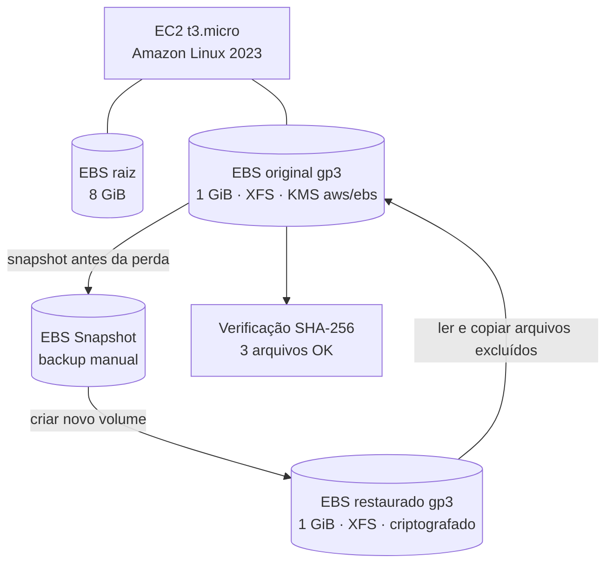

O volume EBS adicional precisa estar na **mesma Availability Zone da instância EC2**. A criptografia em repouso foi configurada com a chave AWS gerenciada `aws/ebs`. Um snapshot EBS captura os blocos de dados usados pelo volume; não é uma cópia lógica de arquivos individualmente.

## Serviços e ferramentas

| Tecnologia | Aplicação |
|---|---|
| Amazon EC2 | Servidor Linux da simulação (`t3.micro`) |
| Amazon EBS | Volumes `gp3` de 1 GiB, original e restaurado |
| AWS KMS | Criptografia em repouso usando `aws/ebs` |
| EBS Snapshots | Ponto de recuperação criado antes do incidente |
| Amazon Linux 2023 + XFS | Formatação, montagem, acesso ao volume e recuperação |
| `lsblk`, `df`, `mount`, `umount` | Inventário e operação segura dos discos |
| `sha256sum` | Comparação criptográfica do conteúdo |
| Tags AWS | Identificação e organização dos recursos |

## Execução e evidências

### 1. Servidor Linux e EBS adicional

A instância foi iniciada, verificada e acessada pelo EC2 Instance Connect. Foi criado um volume `gp3` de 1 GiB, criptografado com a chave `aws/ebs`, na `us-east-1c`. O disco adicional apareceu como `/dev/nvme1n1`, distinto do disco raiz `/dev/nvme0n1`.

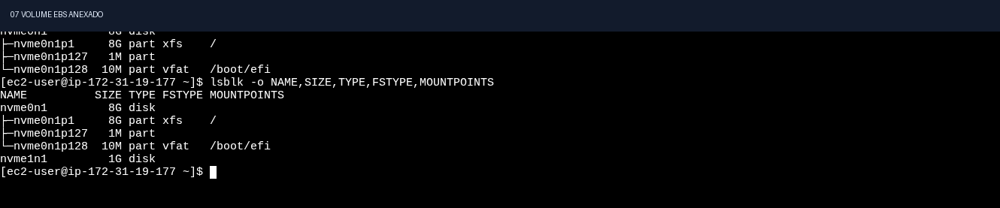

### 2. Sistema de arquivos e dados fictícios

O disco adicional foi formatado em XFS e montado em `/mnt/ebs-lab`. Foram criados os arquivos `relatorio-financeiro.txt`, `configuracao-servidor.conf` e `security-events.log`. Os hashes SHA-256 originais foram salvos fora do volume a ser afetado, em `~/hashes-originais.sha256`.

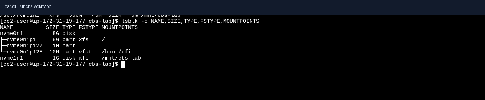

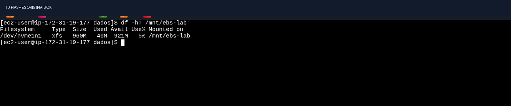

### 3. Snapshot consistente

Após `sync`, o volume foi desmontado antes da solicitação de snapshot manual. O snapshot foi concluído com progresso de 100%.

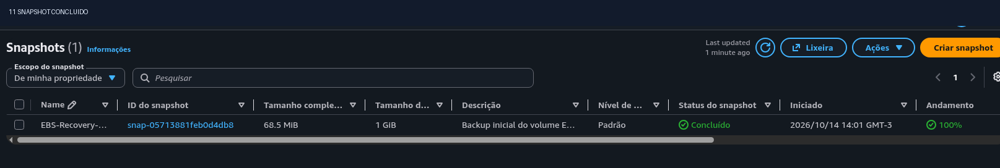

### 4. Incidente simulado

Foram excluídos **somente dois arquivos fictícios** do EBS original: `relatorio-financeiro.txt` e `security-events.log`. A validação acusou dois arquivos ausentes; `configuracao-servidor.conf` permaneceu válido.

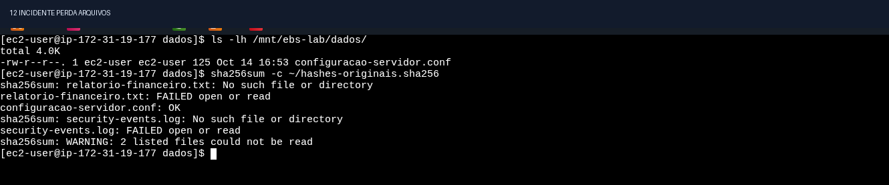

### 5. Recuperação e integridade

Um segundo volume foi criado a partir do snapshot, sem formatá-lo novamente. O XFS restaurado foi montado em modo somente leitura com as opções `ro,nouuid,norecovery`, apropriadas neste laboratório. Os arquivos perdidos foram copiados de volta ao volume original, com nova verificação de integridade.

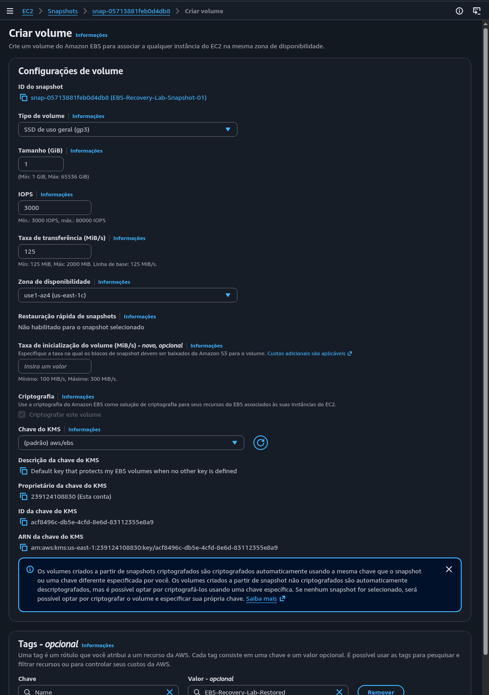

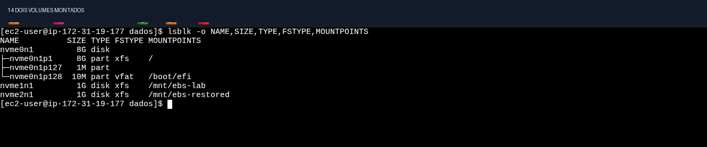

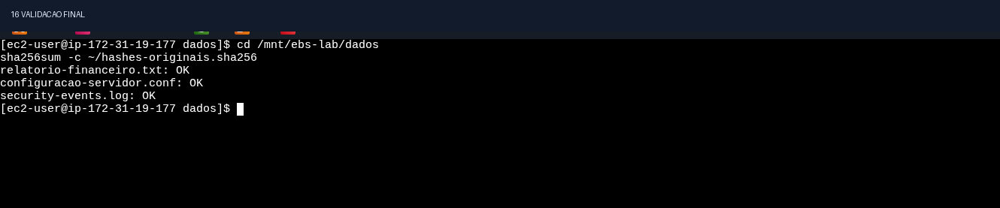

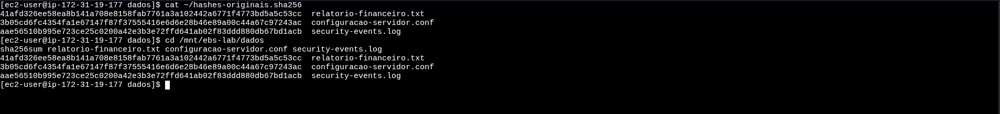

### 6. Tempo de recuperação e encerramento

Os marcadores de tempo foram gravados no Linux no início do incidente e ao final da recuperação. O intervalo calculado foi de **783 segundos (13 minutos e 3 segundos)**.

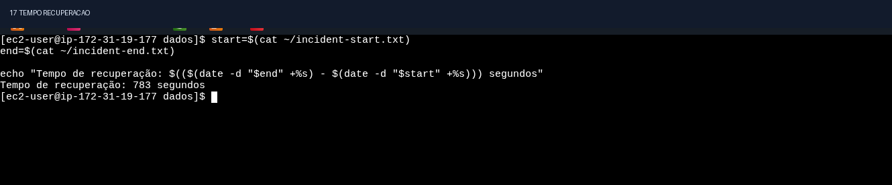

Ao final do laboratório, os volumes de dados foram desmontados e removidos, o snapshot foi excluído e a EC2 foi encerrada. Os registros são evidências pontuais, não uma auditoria de cobrança de toda a conta AWS.

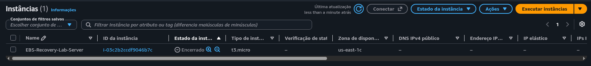

## Comandos principais

> **Não execute a formatação sem validar o dispositivo com `lsblk` e `file -s`. Os caminhos NVMe podem mudar entre instâncias.** O exemplo abaixo registra os comandos usados na execução, não um script cego para produção.

```bash
lsblk -o NAME,SIZE,TYPE,FSTYPE,MOUNTPOINTS
sudo file -s /dev/nvme1n1
sudo mkfs.xfs -f /dev/nvme1n1  # APENAS volume vazio identificado
sudo mkdir -p /mnt/ebs-lab
sudo mount /dev/nvme1n1 /mnt/ebs-lab
sudo mkdir -p /mnt/ebs-lab/dados
sudo chown ec2-user:ec2-user /mnt/ebs-lab/dados

cd /mnt/ebs-lab/dados
sha256sum *.txt *.conf *.log > ~/hashes-originais.sha256
sha256sum -c ~/hashes-originais.sha256
sync
cd ~
sudo umount /mnt/ebs-lab
# Criar snapshot no console AWS, aguardar conclusão e montar original novamente.

# Após a exclusão simulada, criar e anexar volume A PARTIR do snapshot.
sudo mkdir -p /mnt/ebs-restored
sudo mount -t xfs -o ro,nouuid,norecovery /dev/nvme2n1 /mnt/ebs-restored
cd /mnt/ebs-restored/dados
sha256sum -c ~/hashes-originais.sha256

cp /mnt/ebs-restored/dados/relatorio-financeiro.txt /mnt/ebs-lab/dados/
cp /mnt/ebs-restored/dados/security-events.log /mnt/ebs-lab/dados/
cd /mnt/ebs-lab/dados
sha256sum -c ~/hashes-originais.sha256
```

Mais detalhes e pontos de atenção: [procedimento de recuperação](docs/recovery-procedure.md).

## Documentação técnica

- [Relatório do incidente e resultados](docs/incident-report.md)
- [Procedimento técnico de recuperação](docs/recovery-procedure.md)
- [Arquitetura e controles de segurança](docs/architecture.md)
- [Índice completo das 26 evidências](docs/evidence-index.md)

## Segurança, limites e melhorias

**Controles demonstrados:** dados fictícios, SSH restrito, EBS criptografado em repouso, separação entre volume raiz e volume de teste, referência de hashes fora do volume afetado, snapshot consistente, montagem do volume restaurado em somente leitura e limpeza dos recursos.

**Limitações:** experimento em uma única zona de disponibilidade; volume pequeno e carga estática; exclusão controlada, não ataque real; métrica de recuperação inclui operações humanas; não foram configurados snapshots automáticos, monitoramento de custos ou plano de continuidade em produção. SHA-256 verifica conteúdo, não substitui testes funcionais de aplicações nem garante todos os metadados.

**Possíveis evoluções:** política de snapshots com Amazon Data Lifecycle Manager (DLM), alarmes de backup, testes periódicos de restauração, cópia de snapshots entre regiões e infraestrutura como código com CloudFormation/Terraform.

## Referências oficiais

- [Amazon EBS snapshots](https://docs.aws.amazon.com/ebs/latest/userguide/ebs-snapshots.html)
- [Criar volume a partir de um snapshot](https://docs.aws.amazon.com/ebs/latest/userguide/ebs-restoring-volume.html)
- [Tornar um volume EBS disponível para uso](https://docs.aws.amazon.com/ebs/latest/userguide/ebs-using-volumes.html)
- [Criptografia do Amazon EBS](https://docs.aws.amazon.com/ebs/latest/userguide/ebs-encryption.html)
- [Amazon Data Lifecycle Manager](https://docs.aws.amazon.com/ebs/latest/userguide/snapshot-lifecycle.html)

---

**Laboratório concluído em 14/10/2026.** Projeto educacional de Cloud Security, Linux e recuperação de dados.
