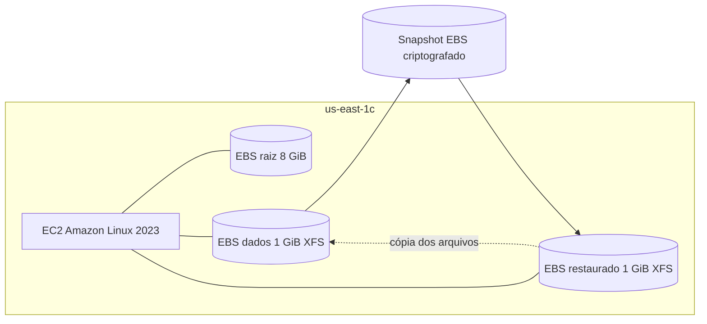

# Arquitetura e decisões de segurança

## Componentes

- **Amazon EC2:** instância `t3.micro` com Amazon Linux 2023, região `us-east-1`, zona de disponibilidade `us-east-1c`.
- **Raiz:** EBS de 8 GiB usado pelo sistema operacional.
- **Volume de dados:** EBS `gp3` de 1 GiB, criptografado com AWS KMS `aws/ebs`; formato XFS e montagem `/mnt/ebs-lab`.
- **Backup:** snapshot manual criado após desmontagem do volume de dados, concluído com 100%.
- **Restauração:** segundo EBS `gp3` de 1 GiB derivado do snapshot e montado separadamente em `/mnt/ebs-restored`.
- **Integridade:** SHA-256 dos três arquivos fictícios, com manifesto fora do volume de dados.

## Decisões de segurança

1. **Separação:** volume raiz mantido distinto do volume de teste para limitar dano operacional.
2. **Princípio do menor acesso de rede:** regra SSH restrita e ajuste específico para o acesso EC2 Instance Connect, sem liberar a porta para `0.0.0.0/0`.
3. **Criptografia em repouso:** EBS e backup criptografados usando a chave gerenciada `aws/ebs`. Esse controle não substitui autenticação IAM e proteção de rede.
4. **Consistência de backup:** `sync` e desmontagem do XFS antes de criar o snapshot.
5. **Proteção da cópia:** volume restaurado montado com `ro,nouuid,norecovery` para leitura sem alteração do backup.
6. **Verificação independente:** manifesto SHA-256 salvo no volume raiz, fora do volume afetado.
7. **Ciclo de vida:** tags de projeto para rastreabilidade, limpeza após o experimento.

## Limitações

- Não houve replicação entre AZs ou regiões.
- Não foi executado DLM nem AWS Backup; snapshot criado manualmente.
- O caso demonstra restauração de **conteúdo de arquivos** e não valida todos os metadados, permissões ou um aplicativo inteiro.
- O tempo medido compreende interação humana e console; não mede RTO/RPO garantidos nem disponibilidade do serviço durante o incidente.
- Capturas de limpeza não substituem auditoria de custo/faturamento.
